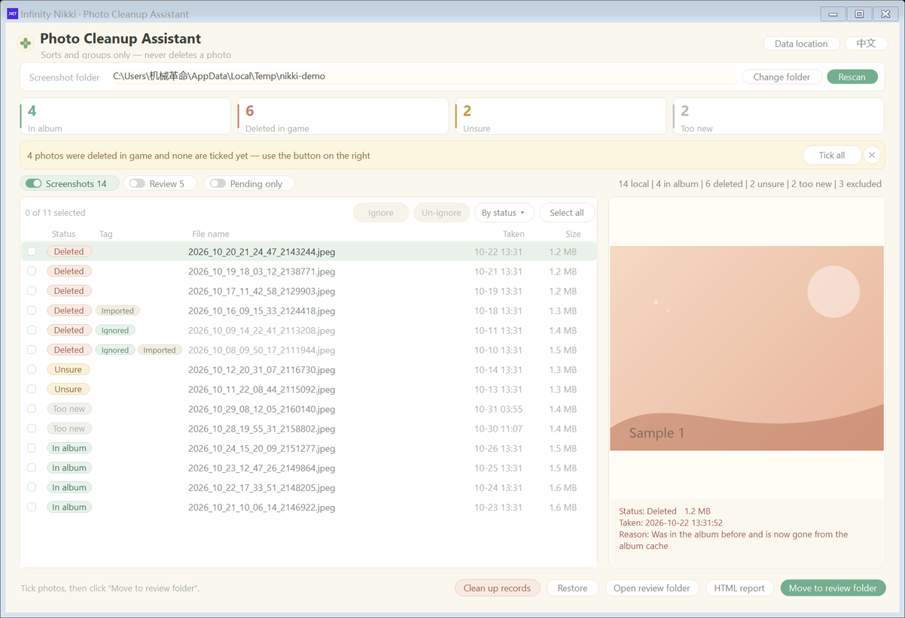
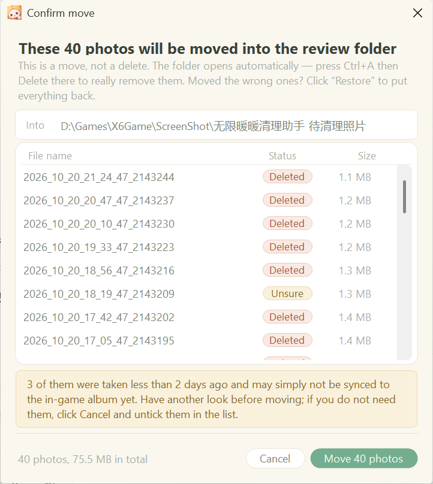
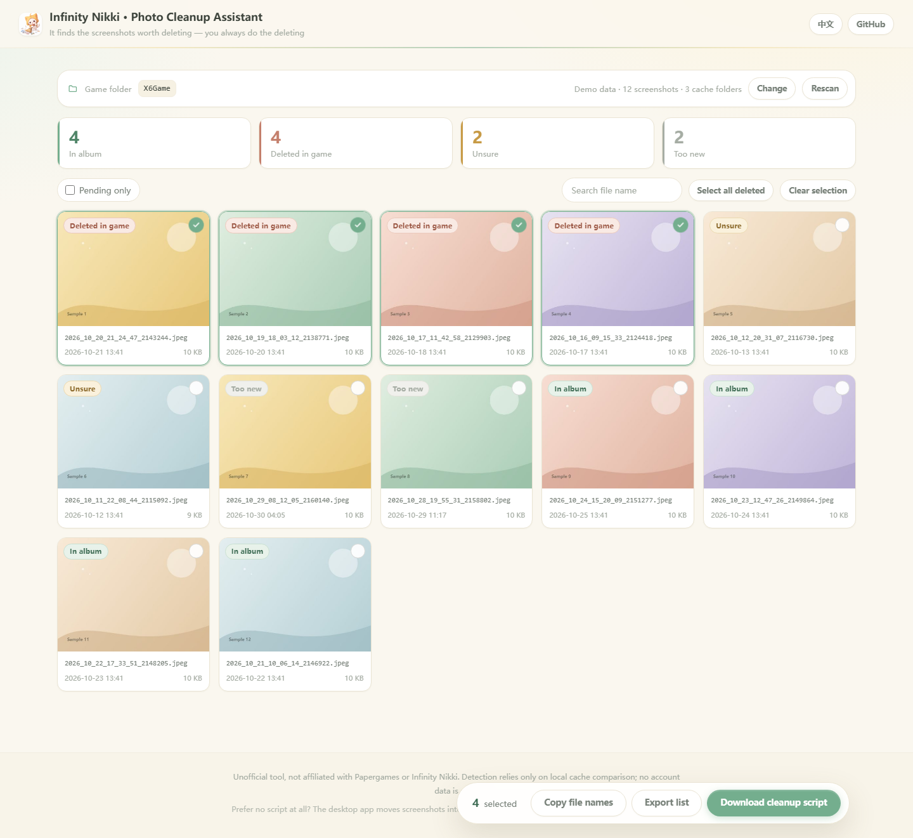
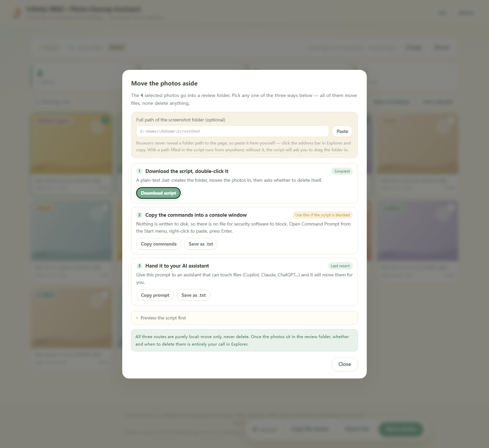

# Infinity Nikki · Local Photo Cleanup Assistant

Finds the photos you already **deleted inside the game but which are still sitting in your `ScreenShot` folder**, and moves them into a separate folder for you to confirm.

**It only identifies and moves. It never deletes a photo.**

English | [简体中文](README.zh-CN.md)

**[→ Try it online](https://3341284397-max.github.io/InfinityNikki-PhotoCleaner/)**　·　**[↓ Download the exe](https://github.com/3341284397-max/InfinityNikki-PhotoCleaner/releases/latest/download/NikkiPhotoCleaner.exe)**　·　the web version installs nothing — pick a folder and go.

No game folder handy? [Open the demo](https://3341284397-max.github.io/InfinityNikki-PhotoCleaner/?demo=1) — it runs on generated sample photos.



---

## The problem

Deleting a photo in-game usually only removes the album reference — the file itself stays in `ScreenShot`.
Over time that folder fills up with photos you can no longer see in game, eating gigabytes you don't dare reclaim
by hand because you can't tell which files are still in use.

This tool makes the question answerable: it tells you which local files are no longer in the album,
moves them aside, and lets you press Delete yourself.

---

## Four statuses

| Status | Meaning | Colour |
|---|---|---|
| **In album** | File name is still listed in the game's album cache; visible in game | green |
| **Deleted** | Was seen in the album before, and is gone from the cache now | clay |
| **Unsure** | Not in the album cache, and the tool has never seen it (old files, or first scan after install) | amber |
| **Too new** | Would be Deleted/Unsure, but modified less than 3 days ago — recent screenshots are never auto-selected | grey |

Evidence comes from two places:

- **Album cache list** — file names under `X6Game/Saved/GamePlayPhotos/*/NikkiPhotos_*`
- **Local ledger** — `album-ledger.tsv`, written by the tool, recording "this file was once in the album"

"Deleted" requires **both** conditions: was in the album, and is not any more.
Only this status is pre-ticked. "Unsure" is never auto-selected, because it is the one most likely to be wrong.

---

## Requirements

Three forms, pick one. None of them needs an extra runtime installed.

| Form | OS | Dependency |
|---|---|---|
| **Desktop exe** (recommended) | Windows 10 version 1903+ / Windows 11, 64-bit | .NET Framework 4.8 — **shipped with Windows since 10 1903**, nothing to install |
| **PowerShell** | Windows 10 / 11 | **Zero dependencies**, only the built-in PowerShell 5.1 |
| **Web** | Chrome / Edge 86+ on desktop | None. The browser reads the folder locally |

Display: the window defaults to 1180×780 and scales with 100% / 125% / 150% DPI settings.

### About the unsigned binary

The exe is not code-signed. Windows may block it in one of two ways:

| Mechanism | Where | What you see | What to do |
|---|---|---|---|
| **SmartScreen** | Win10 and Win11 | "Windows protected your PC" | *More info* → *Run anyway* |
| **Smart App Control (SAC)** | Win11 clean installs only, on by default | Blocked outright, **no override button** | Use the PowerShell or web version |

**Why there is no signature.** SAC trusts only certificates chaining to a CA in the
Microsoft Trusted Root Program, and it evaluates that in the cloud — it does not consult
the local certificate store. A **self-signed certificate is therefore useless against SAC**,
even if you manually install the root into Trusted Root Certification Authorities.
The options that actually work:

| Option | Cost | Availability for individuals |
|---|---|---|
| Azure Artifact Signing (formerly Trusted Signing) | $9.99/month | Individuals: USA and Canada only |
| OV / EV code signing certificate | $150–400/year | Identity validation plus a hardware token; max 460-day validity, renew and re-sign on expiry |
| Microsoft Store listing | $19 one-off | Microsoft re-signs the package, bypassing both mechanisms |

That cost is out of proportion for a free open-source utility, so this project ships unsigned
and offers the **zero-dependency PowerShell version** as the reliable alternative.

> Windows 10 has no SAC feature at all — Win10 users only ever hit the first row.

---

## Usage

### 1. Desktop exe

1. Download `NikkiPhotoCleaner.exe` and double-click it
2. *Change folder* → pick `X6Game\ScreenShot` (the game root also works, it will find the right subfolder)
3. *Rescan*
4. Review the pre-ticked **Deleted** items. The strip above the list shows `N of M selected`
   plus a *Select all* button — no need to click a hundred circles one by one. `Ctrl+A` works too
5. *Move to review folder* — files are **moved**, not deleted
6. Open that folder, check, then delete them yourself

Before anything moves, a confirmation window lists every single file (the list scrolls, so
hundreds of photos are all there):



### 2. PowerShell, zero dependency

Four double-click `.bat` launchers live in `package/`: scan, move, restore, and clean-up-tool-records.
`src/scripts/PhotoSync.ps1` can also be called directly; see the comment header for parameters.

### 3. Web

Open `web/index.html` in Chrome or Edge and pick the folder.
No game folder? Click *See a demo first*, or open with `?demo=1`.



Browsers are not allowed to move local files from a page, so the web version hands
that one step back to you. Tick the photos, press *Move photos*, and the dialog offers
three routes — pick whichever works on your machine:

**1. Download the script and double-click it** (easiest)
You get a `.bat` of a few KB. Drop it into `X6Game\ScreenShot` and run it. If you paste
the full screenshot-folder path into the dialog first, the script runs from anywhere.

**2. Copy the commands into a console window** (use this when the script gets blocked)
Nothing is written to disk, so there is no file to block. Open Command Prompt from the
Start menu, right-click to paste, press Enter. Each photo is one `if exist … move …`
line — name clashes become `_1`, nothing is overwritten — and a leading `chcp 936`
keeps Chinese paths readable.

**3. Copy the prompt and hand it to your AI assistant** (last resort)
Give the prompt from the dialog to an assistant that can touch files (Copilot, Claude,
ChatGPT…). It states the source folder, target folder, the file list, and the rules:
move only, never delete, do not overwrite.

All three can be previewed first via *Preview the script first*.



A few details:

- **Why you paste a path.** Browsers never reveal a folder path to the page — only the
  folder name. Paste the full path once in the dialog (click the address bar in Explorer
  to copy it) and it is remembered; the script and the commands then locate the folder
  themselves instead of asking you to drag it in
- The script first looks for one of the listed photos next to itself, then in a
  `ScreenShot\` subfolder. Only if neither works does it ask you to drag the folder in
- Photos that are already gone count as *skipped*, not failed. If nothing moves, no
  empty folder is left behind
- The Chinese script is written as **GBK**. `cmd` reads a batch file byte by byte in the
  console code page, so a UTF-8 Chinese batch file misparses lines — in testing it ran
  the "delete yourself?" prompt as a command
- **If the script gets blocked.** A `.bat` downloaded from a browser carries the
  mark-of-the-web, and SmartScreen or a security suite may refuse to run it at all —
  even *More info → Run anyway* is sometimes not offered. It is not the contents
  (a few dozen `move` lines), it is the extension. The easy way around it is route 2
  above: no file on disk, nothing to block. Routes 3 and the exe are there as backup

> If you would rather move files with a single click, use the exe — it moves locally and
> can restore in one click. The web version's value is installing nothing at all, and
> never tripping Smart App Control on an unsigned binary.

---

## Safety guarantees

Designed so that a mis-click still cannot lose a photo:

- **No deletion.** There is no code path that deletes a photo; "move" is a plain `File.Move`
- **Undoable.** Every move writes `last-move.txt` with source and destination;
  *Restore last move* puts everything back
- **Record cleanup never touches photos.** It only clears the tool's own thumbnail cache, reports and ledger.
  Risky items (ledger, move record) are unticked by default and require a second confirmation
- **No network.** Everything is local; no account, no upload
- **Separate data folder.** All intermediate files stay inside the tool's own data directory

---

## Where files go

Created next to the executable:

| Item | Chinese UI | English UI |
|---|---|---|
| Data folder | `无限暖暖清理助手_使用数据` | `NikkiCleaner_Data` |
| Review folder | `无限暖暖清理助手_待清理照片` | `NikkiCleaner_ToDelete` |
| Album ledger | `相册台账.tsv` | `album-ledger.tsv` |
| Reports | `网页报告/` | `reports/` |
| Settings | `设置.txt` | `settings.txt` |
| Move record | `最近一次移动记录.txt` | `last-move.txt` |

**The folder names are resolved once at startup**, by checking which one already exists.
Switching UI language therefore never creates a second set of folders, and the ledger and move record stay intact.
If both exist (an upgraded install), the Chinese one wins.

---

## Bilingual UI

Switch language from the top-right button. English UI uses Segoe UI and English folder names;
Chinese UI uses Microsoft YaHei UI and Chinese folder names. The choice is persisted in the settings file.

---

## Build from source

Requires the .NET SDK.

```bash
cd src/app
dotnet build -c Release
# output: bin/Release/net48/NikkiPhotoCleaner.exe (single file, ~100 KB)
```

## Repository layout

```
src/app/        C# WinForms sources (Program.cs / Theme.cs / L10n.cs / Config.cs / RecordCleaner.cs)
src/scripts/    Zero-dependency PowerShell version (lang/PhotoSync.en.ps1 holds the English strings)
src/test/       Regression host (net8); run-tests.sh covers 13 cases
web/            Static web version (index.html / styles.css / app.js)
package/        Four double-click .bat launchers, in Chinese and English
src/pack/       Builds the share package for cloud drives (exe + 使用说明.txt + screenshots)
docs/           Screenshots
```

## Tests

```bash
cd src/test && ./run-tests.sh
```

Covers the status state machine, the "too new" threshold, ledger I/O, move and restore, record cleanup,
and that switching language never splits the data folder (cases 12 and 13).

## Known limitations

- Detection relies on the game's album cache layout (`Saved/GamePlayPhotos/*/NikkiPhotos_*`).
  A major game update that changes that layout would require adjusting the scanner
- Matching is by file name. If the game renames a file, it will show up as "Unsure"
- The web version itself cannot move files (browser sandbox). It only produces a script,
  commands or a prompt for you to run locally, and none of the three can undo a move —
  use the exe or the scripts under `src/scripts` if you want restore
- Only verified on Windows

## License

Source and issue tracker: <https://github.com/3341284397-max/InfinityNikki-PhotoCleaner>

Code is released under [MIT](LICENSE). The application icon (`src/app/app.ico` — Damiao sweeping up
photos) was made by Lyrins and is released under the same MIT license.

The icon ships two framings: head only for 16–48 px, the full illustration at 64 px and above —
the full scene turns to mush at taskbar size, while the head silhouette still reads.

`docs/icon.png` is a 256 px preview; the full-resolution original (1254 px) is not shipped in the
repo. To change the icon, run `python src/app/make-icon.py <art.png>` — it regenerates `app.ico`,
`web/favicon.png` and `docs/icon.png` in one go.

Not affiliated with Papergames or *Infinity Nikki*. A small local utility made by a player.
