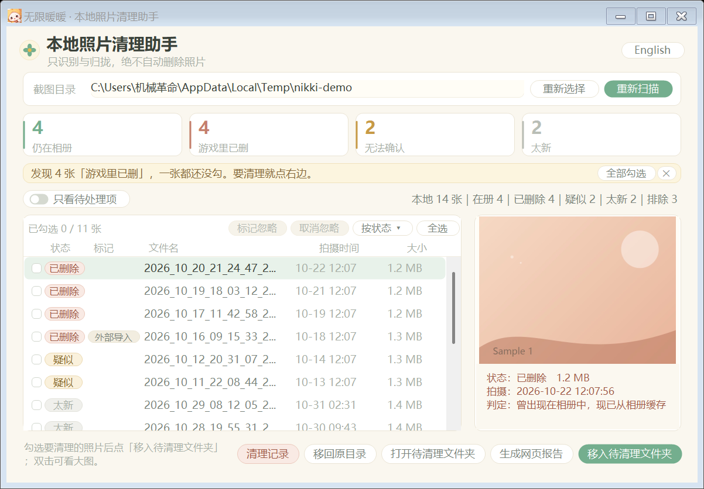
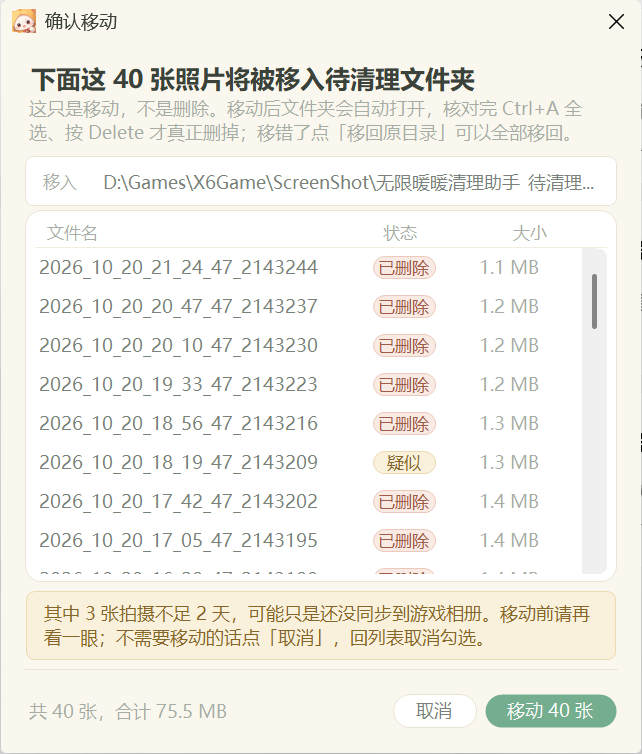
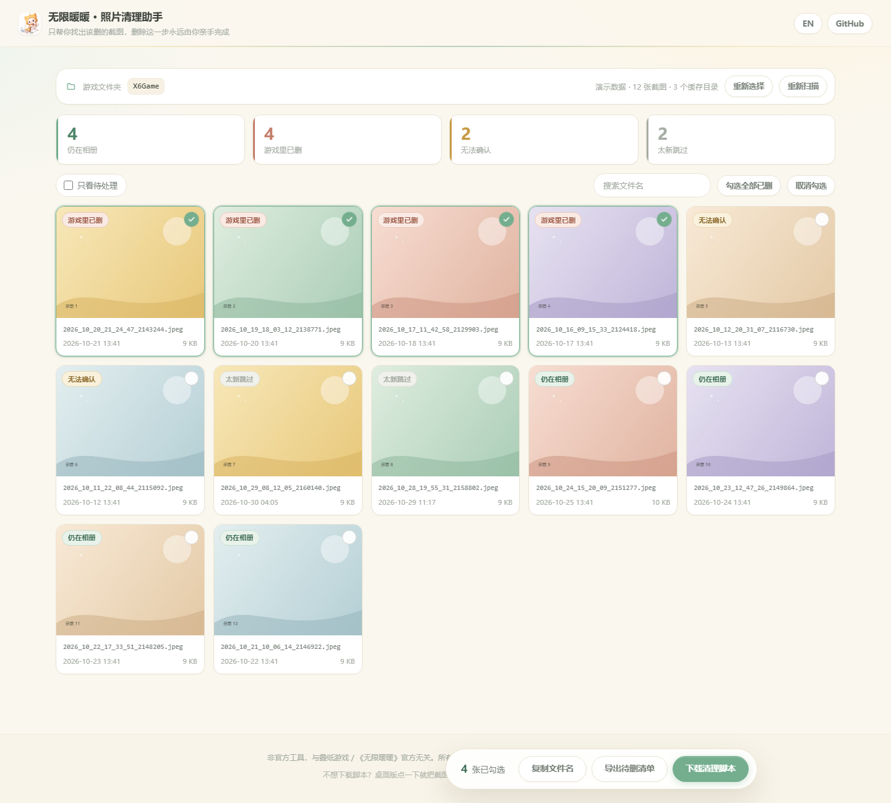
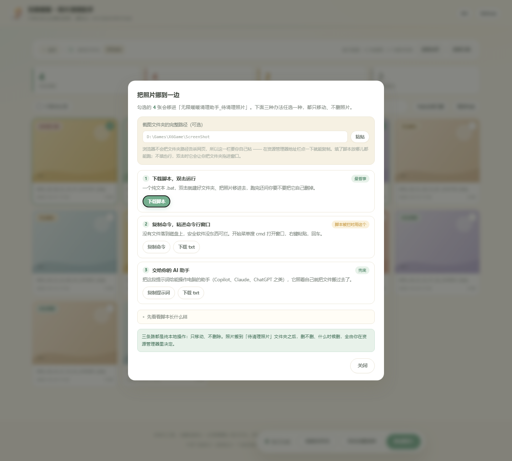

# 无限暖暖 · 本地照片清理助手

识别**游戏里已经删掉、但还留在 `ScreenShot` 文件夹里**的照片，把它们归拢到一个独立文件夹等你确认。

**它只识别与移动，绝不自动删除任何照片。**

简体中文 | [English](README.md)

**[→ 在线体验](https://3341284397-max.github.io/InfinityNikki-PhotoCleaner/)**　·　**[↓ 下载 exe](https://github.com/3341284397-max/InfinityNikki-PhotoCleaner/releases/latest/download/NikkiPhotoCleaner.exe)**　·　网页版不装任何东西，选文件夹就能用。

没有游戏目录？[直接看演示](https://3341284397-max.github.io/InfinityNikki-PhotoCleaner/?demo=1)，用的是生成的样例照片。



---

## 它解决什么问题

游戏内删除照片，删掉的往往只是相册里的引用，本地文件仍然留在 `ScreenShot` 目录里。
时间一长，这个目录会堆满「游戏里根本看不到」的照片，占着几个 G 的空间，又不敢手动删——
因为你分不清哪张还在用、哪张已经废弃。

这个工具做的就是把这件事**变得可以分辨**：告诉你哪些照片游戏里已经没有了，并把它们挪到一边，
最后由你自己按 Delete。

---

## 四种判定

| 判定 | 含义 | 颜色 |
|---|---|---|
| **在册** | 文件名仍出现在游戏的相册缓存里，游戏内可见 | 绿 |
| **已删除** | 曾经在相册里出现过，现在相册缓存里已经没有了 | 赭红 |
| **疑似** | 相册缓存里没有，工具也从没见过它（旧照片，或新装工具后的首次扫描） | 琥珀 |
| **太新** | 属于「已删除 / 疑似」，但修改时间不足 3 天——刚截的图不参与判定，避免误伤 | 灰 |

判定依据来自两处：

- **相册缓存名单**：`X6Game/Saved/GamePlayPhotos/*/NikkiPhotos_*` 下的文件名
- **本地台账**：工具自己记的 `album-ledger.tsv`，记录「这张照片曾经在册」

「已删除」需要**曾经在册、现在不在**两个条件同时成立。只有这一条会默认勾选，
「疑似」永远需要你手动勾——因为它最可能是误判。

---

## 运行环境

三种形态，任选一种，都不需要装运行库。

| 形态 | 系统要求 | 依赖 |
|---|---|---|
| **exe 版**（推荐） | Windows 10 version 1903 及以上 / Windows 11，64 位 | .NET Framework 4.8，**Win10 1903 起系统自带**，无需另装 |
| **PowerShell 版** | Windows 10 / 11 | **零依赖**，只用系统自带的 PowerShell 5.1 |
| **网页版** | Chrome / Edge 86+ 桌面版 | 无。浏览器本地读取文件夹，不装任何东西 |

分辨率：窗口默认 1180×780，支持 100% / 125% / 150% 缩放，窗口会按 DPI 同比放大。

### 关于未签名程序

exe 没有代码签名，Windows 可能以两种方式拦截，处理办法不同：

| 拦截方式 | 出现在 | 现象 | 怎么办 |
|---|---|---|---|
| **SmartScreen** | Win10 / Win11 都有 | 「Windows 已保护你的电脑」 | 点「更多信息」→「仍要运行」 |
| **智能应用控制（SAC）** | 仅 Win11 全新安装默认开启 | 直接拒绝，**没有放行按钮** | 改用 PowerShell 版或网页版 |

**为什么不做代码签名。** SAC 只信任链接到 Microsoft Trusted Root Program 中 CA 的证书，
而且这个判断在云端完成，不采信本机证书存储 —— 所以**自签名证书（免费）对 SAC 完全无效**，
手动把根证书装进「受信任的根证书颁发机构」也不行。真正有效的选项：

| 方式 | 费用 | 个人开发者可用性 |
|---|---|---|
| Azure Artifact Signing（原 Trusted Signing） | $9.99/月 | 个人仅限美国、加拿大 |
| OV / EV 代码签名证书 | $150–400/年 | 需实名验证与硬件 token，有效期最长 460 天，到期需续费重签 |
| Microsoft Store 上架 | $19 一次性 | 微软代为签名，完全绕过两种拦截 |

对一个免费开源的小工具来说这个代价不成比例，因此本项目选择不签名，
改为提供**零依赖的 PowerShell 版**作为稳妥的替代路径。

> Windows 10 没有 SAC 这个功能，Win10 用户只会遇到上面第一种情况。

---

## 三种用法

### 1. exe 版

1. 下载 `NikkiPhotoCleaner.exe`，放到任意位置双击运行
2. 点「重新选择」，选 `X6Game\ScreenShot` 目录（选游戏根目录也行，会自动找）
3. 点「重新扫描」
4. 核对默认勾选的「已删除」项。列表上方有 `已勾选 N / M 张` 和「全选」按钮，
   一次勾上百张不用挨个点；键盘 `Ctrl+A` 同样管用
5. 点「移入待清理文件夹」，照片被**移动**（不是删除）到一个独立文件夹
6. 打开那个文件夹，确认无误后自己删

移动前会弹一个确认窗口，把要动的每一张都列出来（列表可滚动，几百张也是全列）：



### 2. PowerShell 零依赖版

`package/` 目录下是四个双击即用的 `.bat`（英文界面用同名的英文版）：

| 文件 | 作用 |
|---|---|
| `零依赖版-检查相册残留.bat` | 只扫描、生成报告，不动任何文件 |
| `零依赖版-执行移动.bat` | 把判定为已删除的照片移入待清理文件夹 |
| `还原上次移动.bat` | 撤销上一次移动 |
| `清理工具记录.bat` | 清理工具自己产生的记录文件 |

也可以直接用 PowerShell 调 `src/scripts/PhotoSync.ps1`，参数见脚本开头注释。

### 3. 网页版

直接用 Chrome / Edge 打开 `web/index.html`，选文件夹即可。
没有游戏目录也可以点「先看演示」，或者带 `?demo=1` 参数打开。



浏览器出于安全不允许网页直接移动本地文件，所以这一步交给你确认一次。
勾好照片后点「移动照片」，弹窗里给了三条路，任选一条：

**① 下载脚本，双击运行**（最省事）
得到一个几 KB 的 `.bat`。把它拖进 `X6Game\ScreenShot` 双击即可；
如果先在弹窗里填了截图文件夹的完整路径，脚本放在哪儿都能直接跑。

**② 复制命令，粘进命令行窗口**（脚本被安全软件拦时用这个）
没有文件落到磁盘，也就没有东西可被拦。开始菜单搜 `cmd` 打开窗口，右键粘贴，回车。
每张照片是一条 `if exist … move …`，撞名改 `_1`、不覆盖；开头 `chcp 936` 保证中文路径不乱码。

**③ 复制提示词，交给你的 AI 助手**（兜底）
把弹窗里那段提示词给能操作文件的助手（Copilot、Claude、ChatGPT 之类）。
里面写清了源目录、目标目录、文件清单，以及「只移动、不删除、重名不覆盖」的要求。

三条路的产物，都可以先展开「先看看脚本长什么样」核对一遍再动手。



几个细节：

- **为什么要你填路径**。浏览器不会把文件夹路径告诉网页，只能拿到文件夹名字。
  在弹窗里粘一次完整路径（在资源管理器地址栏点一下就能复制），之后会记住 ——
  脚本和命令据此直接定位，不用再拖文件夹
- 脚本会先在自己旁边、以及自己旁边的 `ScreenShot\` 里找一张清单里的照片。
  找到了就直接开工；找不到才让你把文件夹拖进窗口
- 原位置已经没有的照片算「跳过」，不算失败；一张都没移动成功时不会留下空文件夹
- 中文脚本按 **GBK** 写入。cmd 按代码页逐字节读文件，用 UTF-8 存的中文批处理会读错行，
  实测会把「要不要删掉自己」当成命令执行
- **脚本被拦了怎么办**。从浏览器下载的 `.bat` 带着网络标记，SmartScreen 或安全软件
  可能连「仍要运行」都不给 —— 这不是脚本内容的问题（它就是几十行 `move`），
  是这个扩展名天生不招人待见。绕过去最省事的是上面第 ② 条：命令不落盘，没东西可拦。
  兜底还有第 ③ 条和 exe 版

> 如果你更想「点一下就移动完」，用 exe 版：它直接在本地移动，还能一键还原。
> 网页版的价值是不装任何东西、也不会有未签名程序被 SAC 拦的问题。

---

## 安全边界

这个工具被设计成「即使误操作也丢不了照片」：

- **不删除**。全流程没有任何删除照片的代码路径，移动也只是 `File.Move`
- **可还原**。每次移动都写一份 `最近一次移动记录.txt`，记下源目录和目标目录，
  「移回原目录」按它还原
- **清理记录不碰照片**。「清理记录」只清工具自己生成的缩略图缓存、报告、台账，
  危险项（台账、还原记录）默认不勾，勾了还要二次确认
- **不联网**。全程本地读写，不上传任何数据，不需要账号
- **数据目录独立**。所有中间文件都放在 `无限暖暖清理助手_使用数据` 里，不污染游戏目录

---

## 数据都放在哪

数据目录建在**程序所在目录**下：

| 内容 | 中文界面 | 英文界面 |
|---|---|---|
| 数据目录 | `无限暖暖清理助手_使用数据` | `NikkiCleaner_Data` |
| 待清理文件夹 | `无限暖暖清理助手_待清理照片` | `NikkiCleaner_ToDelete` |
| 相册台账 | `相册台账.tsv` | `album-ledger.tsv` |
| 网页报告 | `网页报告/` | `reports/` |
| 设置 | `设置.txt` | `settings.txt` |
| 移动记录 | `最近一次移动记录.txt` | `last-move.txt` |

**目录名在程序启动时锁定一次**：只看「已经存在哪一个」。
所以中途切换界面语言**不会**新建另一套目录，台账和还原记录不会断链。
如果两个目录都存在（旧版本升级上来的情况），中文目录优先。

---

## 中英双语

右上角按钮切换界面语言。英文界面用 Segoe UI、英文目录名；中文界面用微软雅黑、中文目录名。
语言选择会记在设置文件里，下次启动沿用。

---

## 从源码构建

需要 .NET SDK（任意版本，能编译 `net48` 即可）。

```bash
cd src/app
dotnet build -c Release
# 产物：bin/Release/net48/NikkiPhotoCleaner.exe（单文件，约 100 KB）
```

## 目录结构

```
src/app/        C# WinForms 源码（Program.cs / Theme.cs / L10n.cs / Config.cs / RecordCleaner.cs）
src/scripts/    PowerShell 零依赖版（含 lang/PhotoSync.en.ps1 英文语言表）
src/test/       回归测试宿主（net8），run-tests.sh 共 13 个用例
web/            网页版（index.html / styles.css / app.js），纯静态
package/        四个双击即用的 .bat 启动器（中英各四个）
docs/           截图
```

## 测试

```bash
cd src/test && ./run-tests.sh
```

覆盖：四种判定的时序、太新阈值、台账读写、移动与还原、记录清理、
中英文切换时数据目录不分裂（用例 12、13）。

## 已知限制

- 判定依赖游戏的相册缓存结构（`Saved/GamePlayPhotos/*/NikkiPhotos_*`）。
  游戏大版本更新若改动该结构，需要相应调整扫描逻辑
- 相册缓存里的文件名与本地文件按文件名匹配。若游戏内改名，会判为「疑似」
- 网页版本身不能移动文件（浏览器沙箱限制），只能生成脚本 / 命令 / 提示词，由你在本地执行；
  这三条路都没有「还原」功能，想撤销请用 exe 版或 `src/scripts` 里的脚本
- 只在 Windows 上验证过

## 许可

源码与问题反馈：<https://github.com/3341284397-max/InfinityNikki-PhotoCleaner>

代码以 [MIT](LICENSE) 发布。程序图标（`src/app/app.ico`：大喵拿着扫帚扫照片）
由 Lyrins 制作，同样以 MIT 许可发布。

图标做了两套取景：16–48 px 只用猫头，64 px 以上用整幅插画 ——
完整插画缩到任务栏尺寸会糊成一团，只留头部轮廓才认得出。

`docs/icon.png` 是 256 px 的预览图，真正的原图（1254 px）不随仓库分发。
要换图标就跑一次 `python src/app/make-icon.py <原图.png>`，
会一并重生成 `app.ico`、`web/favicon.png`、`docs/icon.png`。

本项目与叠纸游戏 / 《无限暖暖》官方无关，是玩家自制的本地小工具。
